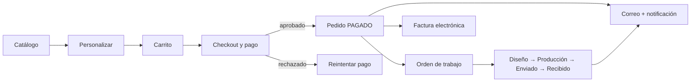

# Studio Creativo Pixel — E-commerce de sublimación y diseño personalizado

Aplicación web para que los clientes de **Studio Creativo Pixel** exploren el catálogo, **personalicen** productos (color, diseño, talla, material, archivo propio), **paguen en línea** y sigan su pedido hasta la entrega, mientras el estudio recibe la **orden de producción** y la **factura electrónica** de forma automática.

Módulo **PPO — Pedidos y Pago Online** · Versión **1.0 (MVP)** · Proyecto de formación SENA (ADSO)

> **Estado:** MVP funcional de extremo a extremo. La **pasarela de pago y la facturación electrónica funcionan en modo simulado** (ver [Alcance y límites](#alcance-y-límites-del-mvp)); no procesan dinero ni documentos con validez fiscal.

---

## El problema que resuelve

Studio Creativo Pixel ofrece servicios y productos de diseño gráfico, impresión y sublimación (tazas, hoodies, gorras, carcasas, vasos…). Vender productos **personalizados** es más complejo que vender un producto de estantería: cada pedido lleva decisiones (color, talla, material, diseño, archivo, notas) y varias etapas (pago, diseño, producción, envío, factura).

Cuando ese proceso se gestiona de forma manual —conversaciones sueltas, pagos por transferencia verificados a mano, hojas de cálculo— aparecen los problemas que este proyecto ataca:

| Problema | Cómo lo resuelve la plataforma |
|---|---|
| El cliente no ve con claridad qué se ofrece, cuánto cuesta ni cuánto tarda | Catálogo interactivo con categorías, precios, tiempos de entrega y filtros |
| Las especificaciones del pedido se pierden o se malinterpretan | Personalización guiada en pasos; la configuración viaja con el pedido hasta producción |
| Cobrar y confirmar pagos consume tiempo y genera errores | Pago en línea (tarjeta / PSE) con confirmación automática y reintento si se rechaza |
| Producción se entera tarde o por varios canales | Al aprobarse el pago se crea **automáticamente la orden de trabajo** |
| El cliente pregunta «¿cómo va mi pedido?» | Estados, historial, fecha estimada de entrega, notificaciones y **correos** automáticos |
| La factura se hace aparte y a mano | **Factura electrónica** generada al pagar, con XML y representación imprimible |
| El dueño no tiene una vista única de la operación | Panel administrativo con pedidos, pagos, facturas, catálogo y usuarios |

**Objetivo (según la Ficha Técnica del proyecto):** centralizar y automatizar los procesos de pedidos y pagos, ofreciendo una plataforma fácil de usar para navegar el catálogo, personalizar productos, pagar en línea y dar seguimiento al pedido, para mejorar la eficiencia operativa del estudio y la experiencia del cliente.

---

## Usuarios y roles

| Rol | Qué puede hacer |
|---|---|
| **Visitante** | Ver catálogo y servicios, personalizar y armar un carrito |
| **Cliente** | Todo lo anterior + registrarse, pagar, ver historial, facturas y notificaciones, cancelar pedidos pendientes |
| **Administrador** | Gestionar categorías, productos/servicios y usuarios; ver y avanzar pedidos; ver pagos, facturas y correos |

---

## Funcionalidades del MVP

El MVP es lo mínimo para completar **el ciclo de valor**: *un cliente configura un producto, lo paga, el estudio lo produce y se emite su factura.*

### Tienda (cliente)
- **Catálogo** con categorías, insignias (oferta/nuevo/pro), filtro por categoría y orden por precio.
- **Personalización por pasos**: color (paleta o libre), diseño base, talla, material, **archivo de diseño propio** (PNG, JPG, SVG, PDF, AI, PSD; máx. 10 MB), notas y cantidad, con resumen y total en vivo.
- **Carrito** (agregar, quitar, cantidades) con subtotal, descuento, IVA y total. Se conserva al volver y, con sesión, **se guarda en la base de datos**.
- **Registro e inicio de sesión** con aceptación del tratamiento de datos (Ley 1581 de 2012).
- **Checkout** con datos de contacto, documento y envío; pago con **tarjeta o PSE** (simulados); **reintento** si el pago es rechazado.
- **Mi cuenta**: historial de pedidos con línea de progreso, fecha estimada de entrega, pagos, facturas y notificaciones; cancelación de pedidos pendientes.
- **Factura electrónica** al pagar: consecutivo por resolución, CUFE, XML UBL 2.1, código QR y versión imprimible/PDF.
- **Correos automáticos**: bienvenida, pago aprobado (con factura XML adjunta), pago rechazado, avance de estado y cancelación.
- **Tema oscuro y claro** (accesibilidad AA verificada en el claro).

### Panel administrativo
- **Dashboard** con ventas aprobadas, pedidos por estado, facturas y últimos pedidos.
- **Pedidos**: detalle completo (productos, personalización, archivos del cliente, pagos, historial) y avance de estado con notificación al cliente: *pagado → diseño → producción → enviado → recibido*; reintento de emisión de factura.
- **Pagos y facturas**: consulta y descarga del XML.
- **Catálogo**: CRUD de categorías y de productos/servicios (precio, tiempo de entrega, tallas, materiales, imagen, destacado).
- **Usuarios**: alta por rol, bloqueo y baja controlada (siempre debe quedar un administrador activo).
- **Correos**: registro de envíos, vista previa de plantillas y correo de prueba.

### Automatizaciones del sistema
Al **aprobarse un pago**: el pedido pasa a *Pagado* → se crea la **orden de trabajo** → se emite la **factura** → se notifica al cliente (en la cuenta y por correo) y al equipo.



---

## Trazabilidad con los requisitos del proyecto

Checklist del módulo PPO (documento de requisitos) frente al MVP:

| ID | Requisito | Estado |
|---|---|---|
| RF-PPO-001 | Catálogo interactivo con categorías y productos | ✅ |
| RF-PPO-002 | Filtros y búsquedas en el catálogo | 🟡 Filtro por categoría y orden por precio en la interfaz; búsqueda por texto disponible en la API (`/api/servicios?q=`), aún sin caja de búsqueda |
| RF-PPO-003 | Personalizar productos antes del carrito | ✅ |
| RF-PPO-004 | Agregar y eliminar productos del carrito | ✅ |
| RF-PPO-005 | Total del carrito actualizado automáticamente | ✅ |
| RF-PPO-006 | Cupón de descuento | ❌ Hoy se aplica un descuento fijo configurable (5 %); los cupones están en el roadmap |
| RF-PPO-007 | Varios métodos de pago (tarjeta, Nequi, PayPal) | 🟡 Tarjeta y PSE simulados; Nequi y PayPal pendientes |
| RF-PPO-008 | Pago seguro, PCI-DSS | 🟡 No se almacenan datos de tarjeta (solo marca y últimos 4); el cumplimiento PCI lo asume la pasarela real al integrarla |
| RF-PPO-009 | Orden de trabajo automática tras el pago | ✅ |
| RF-PPO-010 | Confirmación y recibo por correo o notificación | ✅ Correo + notificación + factura |
| RF-PPO-011 | Almacenar la información de envío | ✅ |
| RF-PPO-012 | Historial de pedidos y estados | ✅ |
| RF-FT-001 | Autenticación con roles (cliente, administrador) | ✅ |
| RNF-SEG-002 | Autenticación de dos factores | ❌ Roadmap |
| RNF-PPO-01 | Carga del catálogo < 2 s | ⚪ No medido formalmente |

✅ cumplido · 🟡 parcial · ❌ fuera del MVP · ⚪ sin medir

---

## Alcance y límites del MVP

**Incluido:** todo lo anterior.

**Simulado (intencionalmente, para la demostración):**
- **Pasarela de pago**: valida tarjeta (Luhn, vencimiento) y devuelve aprobado/rechazado según tarjetas de prueba. No mueve dinero.
- **Factura electrónica**: genera CUFE y XML UBL 2.1 sin firma ni envío a la DIAN → **sin validez fiscal**. Se activa con un proveedor tecnológico autorizado.

**Fuera del MVP (roadmap):** pasarela real (Wompi/PayU/Nequi/PayPal), proveedor de facturación DIAN, cupones, autenticación de dos factores, recuperación de contraseña, panel del rol *Diseñador*, reembolsos y notas crédito, búsqueda por texto en la interfaz, pagos por transferencia manual, reintentos automáticos de correos fallidos.

---

## Tecnología

| Capa | Tecnología |
|---|---|
| Interfaz y servidor | **Next.js 16** (App Router) · React 19 · TypeScript · Tailwind CSS 3 |
| API | Route Handlers REST con validación (zod) y el mismo contrato que `pixel-api` (Spring Boot) |
| Datos | **PostgreSQL** (Supabase) **o MySQL 8** · Prisma 7 |
| Archivos | Supabase Storage (bucket privado, URL firmadas) |
| Correo | **Resend** o SMTP |
| Hosting | **Vercel** + Supabase |
| Seguridad | JWT en cookie `httpOnly`, BCrypt, roles verificados en cada endpoint, RLS en Supabase, precios siempre recalculados en el servidor |

La base de datos tiene **23 tablas** (24 en MySQL): usuarios y roles, catálogo, carrito, pedidos, pagos, órdenes de trabajo, notificaciones, correos y facturación.

---

## Inicio rápido (local)

Requisitos: Node.js ≥ 20.9 y una base PostgreSQL o MySQL 8 (o un proyecto Supabase).

```bash
npm install
cp .env.example .env          # completa DATABASE_URL, DIRECT_URL, AUTH_SECRET, ADMIN_*
# PostgreSQL:  db/01_schema.sql y db/02_seed.sql      ·      MySQL: db/mysql/01_schema.sql y db/mysql/02_seed.sql
npm run db:admin              # crea el primer administrador
npm run dev                   # http://localhost:3000
npm test                      # pruebas unitarias
```

**Tarjetas de prueba:** `4242 4242 4242 4242` (aprobada) · `4000 0000 0000 0002` (rechazada) · `4000 0000 0000 9995` (sin fondos). Fecha futura y cualquier CVV.

## Documentación
- 🚀 **[Guía de despliegue](docs/DESPLIEGUE.md)** — GitHub → Supabase → Resend → Vercel, paso a paso.
- 🧩 **[Guía técnica](docs/GUIA_TECNICA.md)** — arquitectura, base de datos, pagos, facturación, correos, temas y seguridad.

## Estructura del repositorio
```
db/                 Scripts SQL (PostgreSQL) y db/mysql/ (MySQL 8)
prisma/             Esquemas Prisma por motor
docs/               Guías de despliegue y técnica
public/assets/      Logos y fotos de productos
src/app/            Páginas: (tienda), admin, factura, api
src/components/     Interfaz (tienda, admin, proveedores)
src/server/         Servicios de negocio, pagos, facturación, correos, almacenamiento
```
